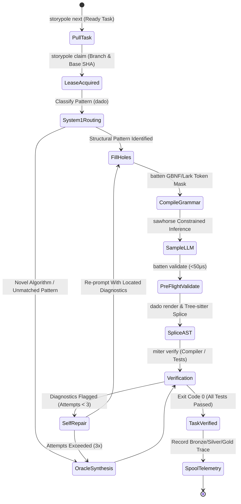
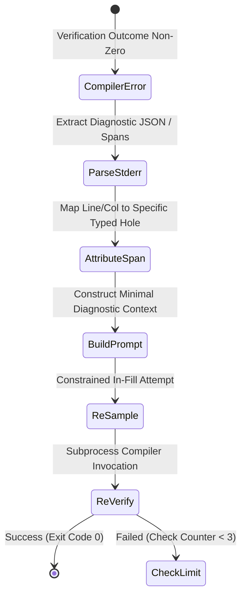

# Behavioral Specifications & Invariants — `joiner`

> **Crates:** `joiner`, `joiner-core`, `joiner-cli`, `joiner-mcp`  
> **Orchestration Model:** Neurosymbolic Synthesis Closed Loop  
> **Schema Version:** `1.0`

---

## 1. Core Behavioral Invariants

### Invariant 1: Verification-Gated Task Completion
* `joiner` never marks a task `Verified` in `storypole` without an unambiguous zero-exit-code compiler check and test suite execution.
* Every completed synthesis run records a cryptographic `VerificationReceipt` containing exit codes, diagnostic counts, and commit SHAs.

### Invariant 2: Bounded Self-Repair Ceiling
* Localized hole-level self-repair is strictly bounded to 3 iterations.
* If compiler diagnostics persist after 3 attempts, `joiner` terminates localized repair and escalates to unconstrained frontier Oracle generation.

### Invariant 3: Ephemeral Worktree Isolation
* When executed with `--sandbox`, all code modifications, compilation runs, and unit tests execute inside a detached git worktree (`git worktree add --detach`).
* The active working tree and index are never modified if verification fails or is interrupted.

### Invariant 4: AST-Anonymized Telemetry Spooling
* Every synthesis trace emitted to the spool outbox (`.gaugeblock/spool/`) passes through `miter` AST secret scrubbing.
* Proprietary variable names and string literals are replaced with canonical placeholders before leaving the machine.

---

## 2. System State Machines

### 2.1 Neurosymbolic Orchestration Loop

### 2.2 Self-Repair Loop Lifecycle

---

## 3. Formal Type Contracts

### Boundary Models, Wire Types & Enums

- **`model::AnonymizedSynthesisTrace`** (`struct`): Sanitized synthesis trace recording pattern, hole fills, and verification receipts per `CONTRACTS.md`.
- **`mod::AppState`** (`struct`): Shared thread-safe application state driving CLI, MCP, and Axum daemon handlers.
- **`verifier::AstVerifier`** (`struct`): Core verification engine managing working tree patching, sandbox isolation, compiler checks, and tests.
- **`args::CliArgs`** (`struct`): Root command-line parser definition for `joiner-cli`.
- **`args::Command`** (`enum`): Top-level CLI subcommands (`RunNext`, `Synthesize`, `Daemon`, `Mcp`, `Telemetry`).
- **`model::CompilerDiagnostic`** (`struct`): Structured compiler warning or error with file span, code, and message.
- **`args::DaemonArgs`** (`struct`): Command-line options for running the Axum HTTP/WebSocket daemon.
- **`model::ExecutionMode`** (`enum`): Target execution environment (`InPlace`, `SandboxWorktree`).
- **`spool::FileSpoolSink`** (`struct`): Local JSONL file-backed telemetry outbox for `rabbet` ingestion.
- **`filler::HoleFillRequest`** (`struct`): Input context driving grammar compilation and constrained LLM completion.
- **`filler::HoleFiller`** (`struct`): Orchestrator combining `batten` grammar compilation, `sawhorse` sampling, and candidate validation.
- **`model::JoinerConfig`** (`struct`): Master orchestration configuration options mapped from `.gaugeblock/config.toml`.
- **`mod::JoinerEngine`** (`struct`): High-level orchestrator executing the end-to-end neurosymbolic synthesis loop.
- **`error::JoinerError`** (`enum`): Primary error enumeration for routing, hole-filling, verification, and spooling.
- **`sink::MemoryTelemetrySink`** (`struct`): In-memory telemetry sink implementation for testing.
- **`oracle::OracleResult`** (`struct`): Synthesis output returned by unconstrained frontier Oracle models.
- **`oracle::OracleRunner`** (`struct`): Fallback engine managing unconstrained frontier LLM calls for novel algorithms.
- **`args::RunNextArgs`** (`struct`): Command-line options for `joiner run-next`.
- **`sink::SpoolEntry`** (`struct`): Serialized telemetry envelope tracked in the local outbox.
- **`sink::SyncStatus`** (`enum`): Outbox synchronization status (`Pending`, `Synced`, `Failed`).
- **`args::SynthesizeArgs`** (`struct`): Command-line options for `joiner synthesize <task_id>`.
- **`model::SynthesisEvent`** (`enum`): Structured event emitted over WebSocket/SSE during live synthesis execution.
- **`model::SynthesisResult`** (`struct`): Final outcome report detailing touched files, iterations, and verification status.
- **`model::SynthesisStrategy`** (`enum`): Routing choice executed for a task (`DadoPattern`, `OracleSynthesis`).
- **`args::TelemetryArgs`** (`struct`): Command-line options for inspecting and exporting telemetry outboxes.
- **`model::TelemetryTier`** (`enum`): Quality classification for training traces (`Bronze`, `Silver`, `Gold`, `Diamond`).
- **`model::VerificationReport`** (`struct`): Diagnostic report produced by compiler and unit test execution.
